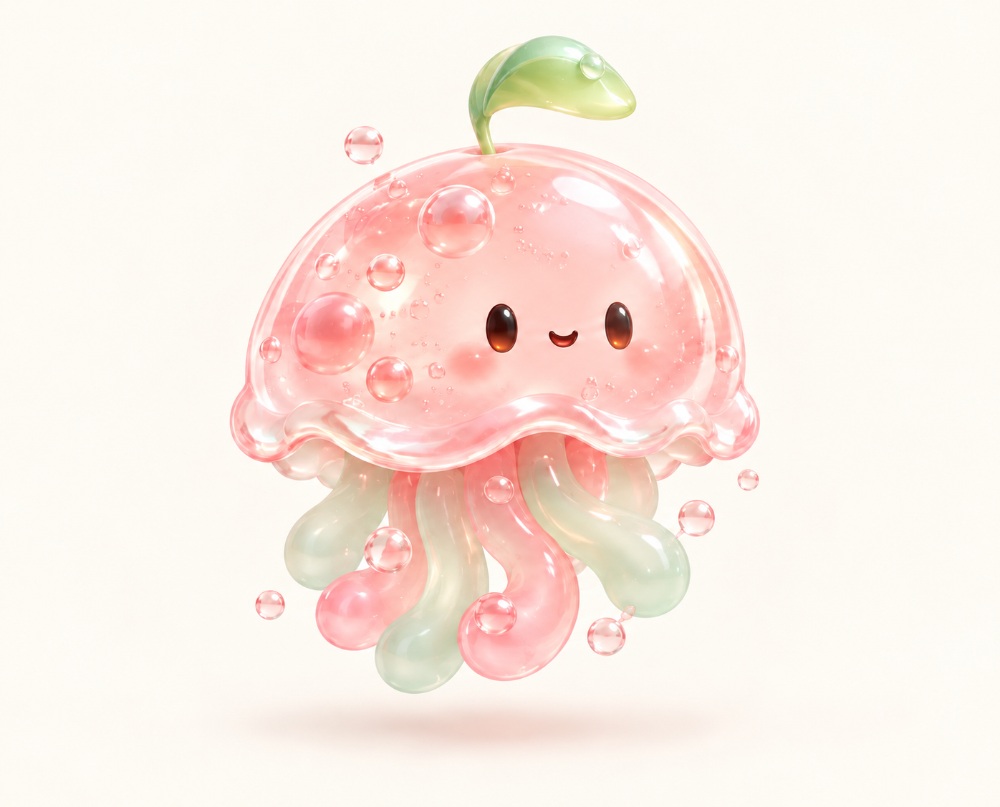
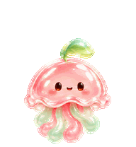
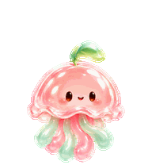
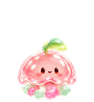

# 새싹 해파리 · Leaf Jellyfish 🌱🫧

[한국어](README.md) · [English](README.en.md) · [日本語](README.ja.md)

파스텔 핑크 젤리 몸에 연두색 잎사귀를 쏙 달았어요.
통통 떠다니고, 눈을 깜빡이고, 촉수로 인사하는 작은 데스크톱 친구예요.

<p align="center">
  
</p>

<p align="center">
  
  
  
</p>

## 내 펫으로 데려오기

1. [새싹 해파리 다운로드](https://github.com/kitschgang/Mypet_for_GPT/raw/refs/heads/main/leaf-jellyfish.zip)를 눌러 내려받고 압축을 풀어 주세요.
2. 압축을 푼 **`leaf-jellyfish` 폴더 전체**를 아래 위치에 넣어 주세요.

   | 운영체제 | 넣을 위치 |
   | --- | --- |
   | macOS | `~/.codex/pets/` |
   | Windows | `%USERPROFILE%\.codex\pets\` |

   `pets` 폴더가 없으면 새로 만들면 돼요. `CODEX_HOME`을 따로 설정했다면 그 폴더 안의 `pets`를 사용해 주세요.

3. 앱에서 **설정 → Pets → Refresh(새로고침) → 새싹 해파리**를 선택해 주세요.
4. 채팅창에 `/pet`을 입력하면 펫을 표시하거나 숨길 수 있어요.

목록에 바로 보이지 않으면 앱을 다시 열고 확인해 주세요.

### Python으로 설치하기

Python 3가 있다면 이 저장소의 **Code → Download ZIP**으로 전체 파일을 내려받고 압축을 푼 폴더에서 아래 명령으로도 설치할 수 있어요. 추가 패키지는 필요 없어요.

```sh
python3 install.py
```

Windows에서는 `py install.py`를 사용할 수 있어요. 기존에 같은 이름의 펫 폴더가 있으면 덮어쓰지 않고 멈춰요.

## 어떤 움직임이 있나요?

| 상태 | 움직임 |
| --- | --- |
| 쉬기 | 조용히 숨 쉬고 눈 깜빡이기 |
| 오른쪽·왼쪽 이동 | 촉수를 찰랑거리며 헤엄치기 |
| 인사 | 촉수를 들어 인사하기 |
| 점프 | 통통 뛰었다 돌아오기 |
| 오류 | 살짝 시무룩해졌다 회복하기 |
| 응답 기다리기 | 고개를 갸웃하며 기다리기 |
| 작업 중 | 집중하며 촉수 움직이기 |
| 검토 | 찬찬히 살펴보고 눈 깜빡이기 |

9가지 상태, 총 57프레임으로 만들었어요. 투명 배경의 1536 × 1872 WebP 파일이며, 각 칸은 192 × 208 픽셀이에요.

## 파일 안내

- `leaf-jellyfish.zip`: 바로 설치할 수 있는 펫 폴더
- `pet.json`, `spritesheet.webp`: 펫 설정과 9가지 동작이 담긴 원본 파일
- `preview-*.gif`: 움직임 미리보기
- `character.png`: 원본 캐릭터 이미지
- `install.py`: 로컬 폴더에 펫을 복사하는 선택형 설치 도구
- `SHA256SUMS`: 펫 파일 확인용 체크섬

캐릭터와 동작은 OpenAI 이미지 생성 도구로 만들고, 프레임 구성·투명 배경·움직임을 확인했어요. OpenAI의 공식 캐릭터는 아니에요.

앱의 펫 기능과 메뉴는 버전에 따라 달라질 수 있어요. [공식 펫 안내](https://learn.chatgpt.com/docs/pets)도 함께 확인해 주세요.
